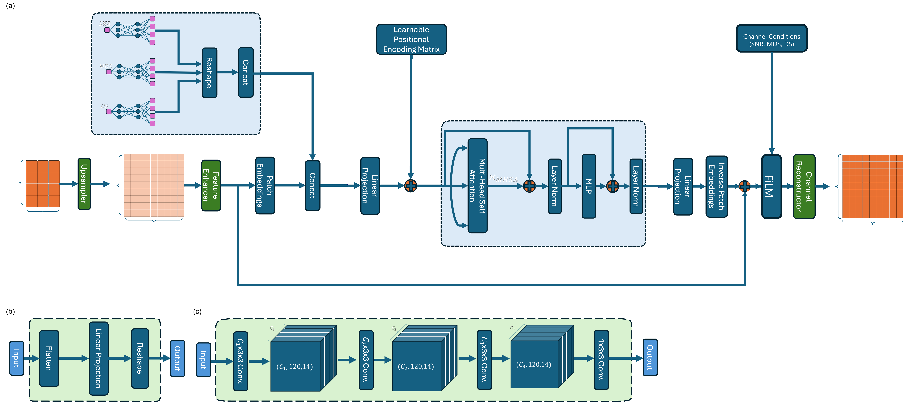

# FortiTranM-FiLM: Feature-Wise Linear Modulated Transformer for Robust 5G NR Channel Estimation

Official implementation for the paper:  
**"FortiTranM-FiLM: Robust Feature-Wise Modulated Transformer for 5G NR Uplink Channel Estimation Under Severe Mobility and Delay Spread Mismatch"**  
*Authors: Mahfoud Faraj Abdulmolla and Osama Abusaid*

Repository: [https://github.com/Mahfoud-Faraj-Abdulmolla/FortiTran-FiLM](https://github.com/Mahfoud-Faraj-Abdulmolla/FortiTran-FiLM)

---

## Overview

Accurate Channel State Information (CSI) is crucial for coherent signal detection and high-order beamforming in 5G New Radio (NR) systems. Standard estimation algorithms (such as LS and LMMSE) and classical deep learning architectures suffer severe performance degradation when operating outside their nominal training distributions—particularly under high Doppler shifts (fast terminal mobility) and large delay spreads (urban multipath).

**FortiTranM-FiLM** addresses these challenges by introducing:
1. **Lightweight Feature-wise Linear Modulation (FiLM)**: Dynamically scales and shifts intermediate latent representations based on estimated physical dispersion statistics, avoiding the parameter explosion and training instability of Channel Attention (CAM).
2. **Two-Stage Transfer Learning Pipeline**:
   - **Stage 1 (Backbone Training)**: 100,000 synthetic 3GPP TDL-A channel realizations trained for up to 1,000 epochs with early stopping (converging at epoch 139).
   - **Stage 2 (FiLM Adaptation)**: Freezing the spatial-temporal transformer backbone and tuning lightweight affine generators over 50 epochs.
3. **High Mobility & Mismatch Resilience**: Achieves over +10.12 dB gain at extreme Doppler spreads (1000 Hz) compared to standard convolution-transformer baselines, while adding only 3,200 trainable parameters (<1.1% overhead).

<p align="center">
  
</p>

---

## Directory Structure

```
FortiTran-FiLM/
├── configs/
│   └── default_config.yaml         # Channel parameters, training hyperparameters
├── matlab_generator/
│   └── generate_3gpp_dataset.m     # 3GPP TR 38.901 TDL-A channel generator (MATLAB)
├── models/
│   └── fortitran_film.py           # PyTorch implementation of FiLM & FortiTranM-FiLM
├── training/
│   └── train_pipeline.py           # 2-stage training script (Backbone + FiLM transfer)
├── evaluation/
│   └── evaluate_robustness.py      # Robustness sweeps (SNR, Delay Spread, Doppler, BER)
├── .gitignore                      # Prevents committing heavy .mat files and .pt weights
├── requirements.txt                # Python dependencies
└── README.md                       # Documentation
```

---

## Installation & Setup

1. **Clone the repository:**
   ```bash
   git clone https://github.com/Mahfoud-Faraj-Abdulmolla/FortiTran-FiLM.git
   cd FortiTran-FiLM
   ```

2. **Create a virtual environment and install dependencies:**
   ```bash
   python -m venv venv
   source venv/bin/activate  # On Windows: venv\Scripts\activate
   pip install -r requirements.txt
   ```

---

## Dataset Generation (MATLAB)

Channel realizations are generated according to 3GPP TR 38.901 specifications using the MATLAB 5G Toolbox.

Run the generator script in MATLAB:
```matlab
run('matlab_generator/generate_3gpp_dataset.m')
```
Parameters configured by default:
- Carrier Frequency: 3.5 GHz
- Subcarrier Spacing: 30 kHz (Numerology $\mu=1$)
- Grid Size: 612 subcarriers $\times$ 14 OFDM symbols (1 slot, 51 Resource Blocks)
- Pilot Pattern: DM-RS Configuration Type 1 (density 1/6)
- Channel Profile: TDL-A (NLOS), $\tau_{\mathrm{rms}} = 150$ ns, $f_d = 200$ Hz

---

## Training Pipeline

Train the network using the two-stage procedure:

### Stage 1: Backbone Training (with Early Stopping)
```bash
python training/train_pipeline.py --stage 1 --dataset_path data/train_channels.mat --epochs 1000 --batch_size 64
```

### Stage 2: FiLM Adaptation (Transfer Learning)
```bash
python training/train_pipeline.py --stage 2 --backbone_weights checkpoints/backbone_stage1.pt --epochs 50 --batch_size 64
```

---

## Evaluation & Benchmarking

Evaluate NMSE and BER performance across standard test conditions:
```bash
python evaluation/evaluate_robustness.py --weights checkpoints/fortitran_film_final.pt
```

### Benchmark Summary:
- **SNR Sweep (0 to 25 dB)**: Demonstrates consistent +0.63 to +0.65 dB NMSE improvement across all SNR operating points compared to baseline FortiTran.
- **Extreme Mobility ($f_d = 1000$ Hz)**: Maintains robust channel tracking (-17.43 dB NMSE) where conventional models fail (-7.31 dB).
- **QPSK BER**: Tightly tracks the Perfect CSI lower bound with near-zero degradation across SNR levels.

---

## Citation

If you use this codebase or architecture in your research, please cite our work:

```bibtex
@article{abdulmolla2025fortitran,
  author    = {Abdulmolla, Mahfoud Faraj and Abusaid, Osama},
  title     = {FortiTranM-FiLM: Robust Feature-Wise Modulated Transformer for 5G NR Uplink Channel Estimation Under Severe Mobility and Delay Spread Mismatch},
  year      = {2025},
  note      = {Code available at: \url{https://github.com/Mahfoud-Faraj-Abdulmolla/FortiTran-FiLM}}
}
```

---

## License

This project is licensed under the MIT License - see the LICENSE file for details.
